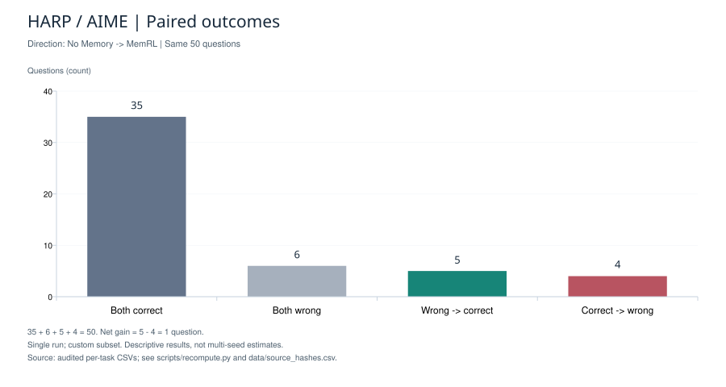
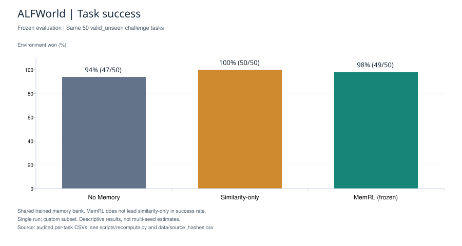
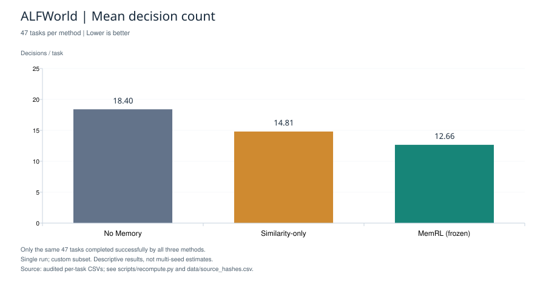

# MemRL Study

A small undergraduate research project on how memory affects AI agents. I started studying [MemRL](https://github.com/MemTensor/MemRL) with the recommendation and support of **Waqar Ali, Associate Professor in CSMT at Wenzhou-Kean University (WKU)**.

## How the project developed

- **Starting with GSM8K:** the model answered 92 of 94 questions correctly without memory. This left little room to measure improvement, a problem known as the *ceiling effect*.
- **Moving to HARP/AIME:** after checking difficulty, I selected Level 6 problems. I worked through issues with reading final answers, responses reaching the output limit, and memory text making prompts too long.
- **Trying ALFWorld:** I extended the study to an environment where an agent takes actions to complete tasks. I selected a fixed set of multi-stage tasks from unseen scenes, using longer reference action sequences to try to increase complexity.

Throughout these changes, I kept training and test tasks separate, compared methods on the same test tasks, and kept memory unchanged during testing.

## Results so far

The experiments used **DeepSeek-flash** and **BGE-M3**. These are results from one run on small, selected subsets.

### HARP / AIME: math problems

Memory was built using 50 training problems. Testing used a fresh set of 50 problems.

| Method | Correct | Accuracy |
|---|---:|---:|
| No Memory | 39/50 | 78% |
| MemRL | 40/50 | 80% |

Compared with No Memory, 5 answers changed from wrong to correct and 4 changed from correct to wrong: a net gain of **one question**. Responses reached the 8,192-token output limit 2 times without memory and 6 times with MemRL. All 50 questions remain in the results.

### ALFWorld: interactive tasks

After one training pass over 100 tasks, I compared three methods on the same 50 unseen tasks.

| Method | Success | Mean decisions: all 50 | Mean decisions: same 47 successful tasks |
|---|---:|---:|---:|
| No Memory | 47/50 (94%) | 20.30 | 18.40 |
| Similarity-based memory | 50/50 (100%) | 15.76 | 14.81 |
| MemRL | 49/50 (98%) | 13.86 | 12.66 |

The last column compares only tasks that **all three methods completed**. MemRL used fewer decisions on average, but its success rate was slightly lower than similarity-based memory. Both memory methods used the same trained memory bank.

## What I learned

Choosing harder or longer tasks does not necessarily remove the ceiling effect. Success rate alone can also miss useful differences. Looking at decision counts, token use, and failed task sequences helped me understand where memory might help and where it can cause problems.

For example, ALFWorld MemRL used 13.6% fewer answer-generation tokens than similarity-based memory, while HARP MemRL used 44.0% more than No Memory. These counts exclude training and Embedding.

These observations need repeated experiments. ALFWorld covers only four room layouts, and all methods received legal-action lists. This is an early adaptation study, with settings different from the original paper.

## Files and next step

- `data/`: numerical results and task identifiers.
- `figures/`: six result charts.
- `scripts/`: offline result checks and plotting code.
- [Experiment notes](docs/methods.md): settings, definitions, and instructions for recreating the charts.

This repository shares the stage report and analysis. The full training setup and raw task records are not included. My next step is to repeat the comparisons and better understand the remaining failures.

Sources: [MemRL paper](https://arxiv.org/abs/2601.03192) · [HARP](https://github.com/aadityasingh/HARP) · [ALFWorld](https://github.com/alfworld/alfworld). Coding and report preparation used AI assistance.
